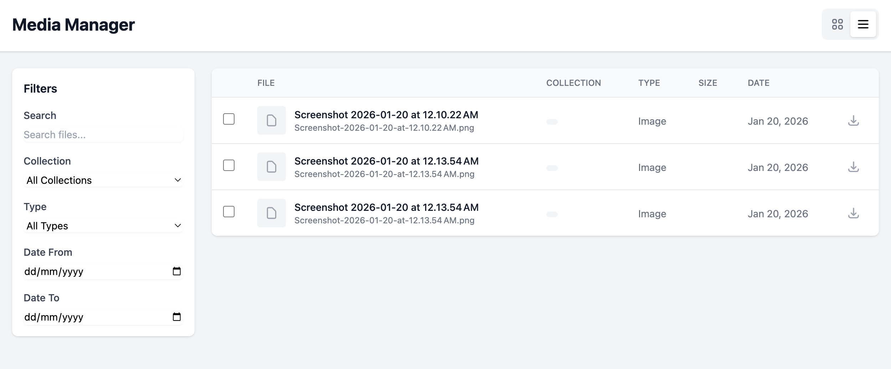
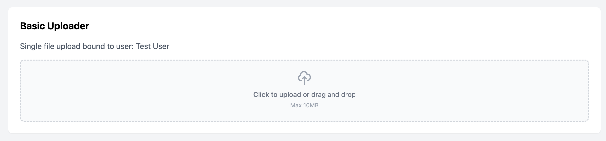
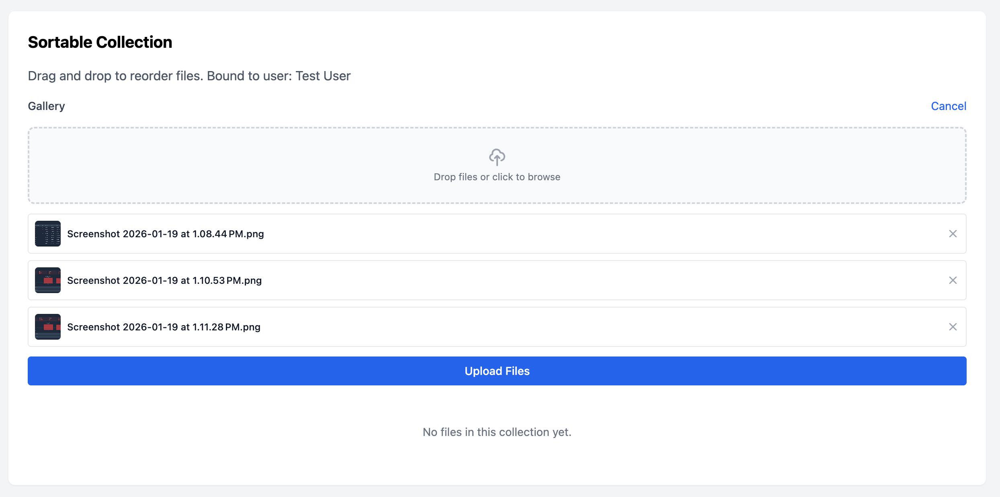

# Spatie Media Library Manager

[](https://packagist.org/packages/cleaniquecoders/media-manager)
[](https://github.com/cleaniquecoders/media-manager/actions?query=workflow%3Arun-tests+branch%3Amain)
[](https://github.com/cleaniquecoders/media-manager/actions?query=workflow%3A"Fix+PHP+code+style+issues"+branch%3Amain)
[](https://packagist.org/packages/cleaniquecoders/media-manager)

A Laravel package that provides a complete media management solution built on top of
[Spatie Media Library](https://spatie.be/docs/laravel-medialibrary). Manage your media files
through a modern, user-friendly interface with Livewire components.

## Features

- Full-featured media browser with grid and list views
- Drag-and-drop file uploads with progress tracking
- Media collection management with reordering support
- Media picker for selecting existing files
- Search, filter, and bulk operations
- Custom properties and metadata support
- Authorization via Laravel gates
- Fully customizable views

## Screenshots

### Media Browser

Browse all your media files with filtering, searching, and bulk operations.



### Media Uploader

Upload files to any model with drag-and-drop support.



### Media Collection

Manage media collections inline with drag-and-drop reordering.



## Installation

Install the package via Composer:

```bash
composer require cleaniquecoders/media-manager
```

Run the install command:

```bash
php artisan media-manager:install
```

Or manually publish and run migrations:

```bash
php artisan vendor:publish --tag="media-manager-migrations"
php artisan migrate
```

Optionally publish the config file:

```bash
php artisan vendor:publish --tag="media-manager-config"
```

## Quick Start

### 1. Add the trait to your model

```php
<?php

namespace App\Models;

use CleaniqueCoders\MediaManager\Concerns\HasMediaManager;
use Illuminate\Database\Eloquent\Model;
use Spatie\MediaLibrary\HasMedia;

class Post extends Model implements HasMedia
{
    use HasMediaManager;

    public function registerMediaCollections(): void
    {
        $this->addMediaCollection('featured')->singleFile();
        $this->addMediaCollection('gallery');
    }
}
```

### 2. Add components to your views

```blade
{{-- Media Browser - embed in your own view with your layout --}}
<livewire:media-manager::browser />

{{-- Media Uploader --}}
<livewire:media-manager::uploader
    :model="$post"
    collection="gallery"
    :max-files="10"
/>

{{-- Media Collection Editor --}}
<livewire:media-manager::collection
    :model="$post"
    collection="gallery"
    sortable
/>

{{-- Media Picker --}}
<livewire:media-manager::picker
    wire:model="selectedMediaIds"
    multiple
/>
```

### 3. Create a route for the media browser

Create your own route and view to display the browser:

```php
// routes/web.php
Route::get('/media', function () {
    return view('media');
})->middleware(['web', 'auth']);
```

```blade
{{-- resources/views/media.blade.php --}}
<x-app-layout>
    <livewire:media-manager::browser />
</x-app-layout>
```

## Using the Facade

```php
use CleaniqueCoders\MediaManager\Facades\MediaManager;

// Upload files
MediaManager::upload($model, $file, 'collection');
MediaManager::uploadMultiple($model, $files, 'collection');

// Browse with filters
$media = MediaManager::browse(['collection' => 'gallery'], perPage: 24);

// Delete media
MediaManager::delete($media);
MediaManager::deleteMultiple([1, 2, 3]);
```

## Moving Media Between Disks or Path Layouts

`media-manager:move-disk` copies Media Library files (originals, conversions and responsive
images) to another disk and/or another path layout, verifies every copy, and only then updates
the `disk` / `conversions_disk` columns of the media row (quietly: no model events, no
`updated_at` bump). Files are streamed, so it works with disks that have no local path, such as S3.

```bash
php artisan media-manager:move-disk --from=<disk> --to=<disk>
    [--from-path-generator=<class>] [--to-path-generator=<class>]
    [--collection=<name>] [--chunk=100] [--dry-run] [--delete-source] [--force]
```

| Option | Meaning |
|---|---|
| `--from` / `--to` | Source and destination disk (required). They may be equal for a re-layout. |
| `--from-path-generator` / `--to-path-generator` | A class implementing Spatie's `PathGenerator`. Each one defaults to the configured generator, including `custom_path_generators`. |
| `--collection` | Only move media of this collection. |
| `--chunk` | Rows per chunk (default 100). |
| `--dry-run` | Print what would move and change nothing. |
| `--delete-source` | Delete the moved source files, plus any of their directories left completely empty. Never deletes a directory that still holds other files. |
| `--force` | Skip the confirmation prompt (needed for unattended runs). |

Only the files a media row owns are touched: the original (`file_name`), its generated
conversions and the files listed in `responsive_images`. Directories are never listed and
copied wholesale, so a directory shared with unrelated files (for example `{id}/` on a disk
used by several databases that each number media from 1) is safe. A missing original fails
that media; a missing conversion or responsive image is skipped.

Conversions are moved only when `conversions_disk` is the `--from` disk, so originals and
conversions stored on different disks can be moved separately. A media whose copy fails keeps
its row and its source files. The error is listed and the run continues with the next media.
The command exits with a failure code when any media failed.

The command works on the default connection of the configured media model, so in a multi-tenant
application you run it once per tenant with your tenancy package's own runner.

### Local disk to S3

```bash
php artisan media-manager:move-disk --from=media --to=s3 --dry-run
php artisan media-manager:move-disk --from=media --to=s3 --force
# once the application reads from s3 without problems:
php artisan media-manager:move-disk --from=media --to=s3 --delete-source --force
```

Re-running is safe. Files already at the destination with a matching size are not copied
again, and an interrupted run finishes on the next pass.

### Changing the path layout on the same disk

To move from `DefaultPathGenerator` (`{id}/`) to your own generator:

1. Deploy the new generator class, leaving `media-library.path_generator` unchanged.
2. Copy the files into the new layout:

   ```bash
   php artisan media-manager:move-disk --from=media --to=media \
       --to-path-generator="App\\Support\\Media\\MyPathGenerator" --force
   ```

3. Set `media-library.path_generator` to the new class and deploy.
4. Sweep anything uploaded between steps 2 and 3, and remove the old files:

   ```bash
   php artisan media-manager:move-disk --from=media --to=media \
       --from-path-generator="Spatie\\MediaLibrary\\Support\\PathGenerator\\DefaultPathGenerator" \
       --delete-source --force
   ```

The command refuses to run when `--from` equals `--to` and both generators resolve to the same class.

## Documentation

For detailed documentation, see the [docs](docs/README.md) directory:

- [Getting Started](docs/01-getting-started/README.md) - Installation and setup
- [Components](docs/02-components/README.md) - All Livewire components
- [Configuration](docs/03-configuration/README.md) - Configuration options

## Testing

```bash
composer test
```

## Changelog

Please see [CHANGELOG](CHANGELOG.md) for more information on what has changed recently.

## Contributing

Please see [CONTRIBUTING](CONTRIBUTING.md) for details.

## Security Vulnerabilities

Please review [our security policy](../../security/policy) on how to report security vulnerabilities.

## Credits

- [Nasrul Hazim Bin Mohamad](https://github.com/nasrulhazim)
- [All Contributors](../../contributors)

## License

The MIT License (MIT). Please see [License File](LICENSE.md) for more information.
